<div align="center">
  

<!-- Animated Header Banner -->

<!-- Typing SVG -->


<br/>

<!-- Profile Views & Social Badges -->

[](www.linkedin.com/in/suhaibsalman/)
[](www.peerlist.io/suhaibsalman)
[](www.medium.com/@SuhaibSalman)


</div>

---

## 👨‍💻 About Me

```dart
class SuhaibSalman extends FlutterDeveloper {

  final String name        = "Suhaib Salman";
  final String role        = " Flutter Engineer";
  final int    experience  = 5; // years
  final String location    = "Pakistan 🇵🇰";

  final List<String> currentFocus = [
    "AI SaaS Products",  
    "Automation workflows",
    "Cross-platform Flutter apps",
    "AI-powered mobile applications",
  ];

  final Map<String, bool> openFor = {
    "Freelance Projects"  : true,
    "Collaborations"      : true,
    "Open Source"         : true,
    "Exciting Flutter"    : true,
  };

  String get motto => "Ship fast. Build clean. Scale smart. 🚀";
}
  🌐 See all projects on my portfolio "https://suhaibsalman.vercel.app"
```

  <!--   Languages & Frameworks -->
  
## 🛠️ Tack Stack
<table >
    <td>
  
</td>
</table>

 <!--  Featured Projects -->

<h2>🚀 Featured Projects</h2>

<table width="100%">
  <tr>
    <td width="25%" valign="top" align="left">
      <br/>
      <h3>Upalerts AI</h3>
      <sub>Productivity</sub>
      <p>Get instant job notifications from Upwork, generate winning proposals with AI.</p>
    </td>
    <td width="25%" valign="top" align="left">
      <br/>
      <h3>Olizon</h3>
      <sub>E-commerce / Olive Oil</sub>
      <p>Modern olive-oil marketplace with auth, explore, cart, and orders.</p>
    </td>
    <td width="25%" valign="top" align="left">
      <br/>
      <h3>e-Shop</h3>
      <sub>Brand / Product</sub>
      <p>Product app under the eShop brand with polished shopping flows.</p>
    </td>
  </tr>
  <tr>
    <td width="25%" valign="top" align="left">
      <br/>
      <h3>Medilis.AI</h3>
      <sub>Health / AI Assistant</sub>
      <p>Personal AI health assistant with chat, pricing plans, and medical records.</p>
    </td>
    <td width="25%" valign="top" align="left">
      <br/>
      <h3>HyFixit</h3>
      <sub>Live Website / Services based</sub>
      <p>Services website designed and built on WordPress.</p>
    </td>
    <td width="25%" valign="top" align="left">
      <br/>
      <h3>Covid-19 Tracker</h3>
      <sub>Open Source / Realtime API</sub>
      <p>Global and per-country COVID-19 statistics with a clean dashboard UI.</p>
    </td>
  </tr>
</table>

##  Github Profile Summary Card
<table>
<tr>
<td align="center">
  
</td>
<td align="center">
  
</td>
</tr>
</table>

##  GitHub Stats
<table>
<tr>
<td>

</td>
<td>

</td>
</tr>
</table>

<div align="center">

### 📡 `System Status: Open for Freelance & Collaborations.`

[](mailto:suhaibsohan007@gmail.com)
[](www.linkedin.com/in/suhaibsalman)
[](https://topmate.io/suhaib_salman)

<br/>
</div>
